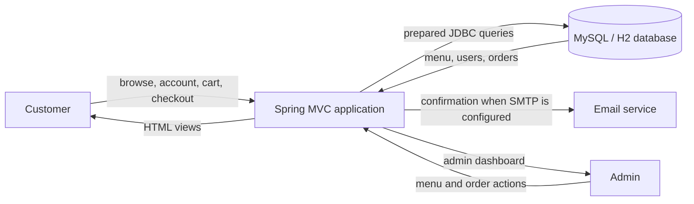
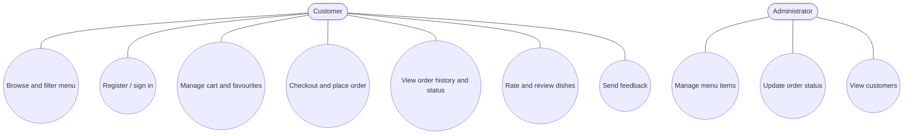

# Project Report: Saffron & Stone

## Overview

An online restaurant ordering application with Spring MVC controllers, Thymeleaf views, JDBC DAO access, and an H2/MySQL database. Customers browse a menu, manage a session cart, order, and follow progress. Administrators manage the menu and order queue.

## ER diagram

```mermaid
erDiagram
  USERS ||--o| ADMIN : has
  USERS ||--o{ CART : owns
  FOOD_ITEMS ||--o{ CART : contains
  USERS ||--o{ ORDERS : places
  ORDERS ||--|{ ORDER_ITEMS : includes
  FOOD_ITEMS ||--o{ ORDER_ITEMS : snapshots
  USERS ||--o{ REVIEWS : writes
  FOOD_ITEMS ||--o{ REVIEWS : receives
  COUPONS { string code PK; int discount_percent; boolean active }
  CONTACTS { bigint id PK; string name; string email; string message }
```

## Data-flow diagram



## Use-case diagram



## Screenshots

Start the app and capture these pages into `docs/screenshots/`: menu and bag (`/`), sign-in/register (`/account`), checkout (`/checkout`), order history (`/orders`), admin studio (`/admin`), and contact (`/contact`). The admin page requires the demo administrator. Do not include real customer data.

## Demo and coupons

- Admin: `admin@saffron.test` / `Admin123!`
- Coupon codes: `WELCOME10` and `FEAST15`
- COD and UPI are demo selections; no payment is collected.

## Future scope

- Live delivery tracking with driver location and status notifications
- Payment gateway integration with verified callbacks and refunds
- Mobile app with push notifications and saved addresses
- Persistent cross-device carts and personalized recommendations
- Email delivery events, account recovery, and rate limiting